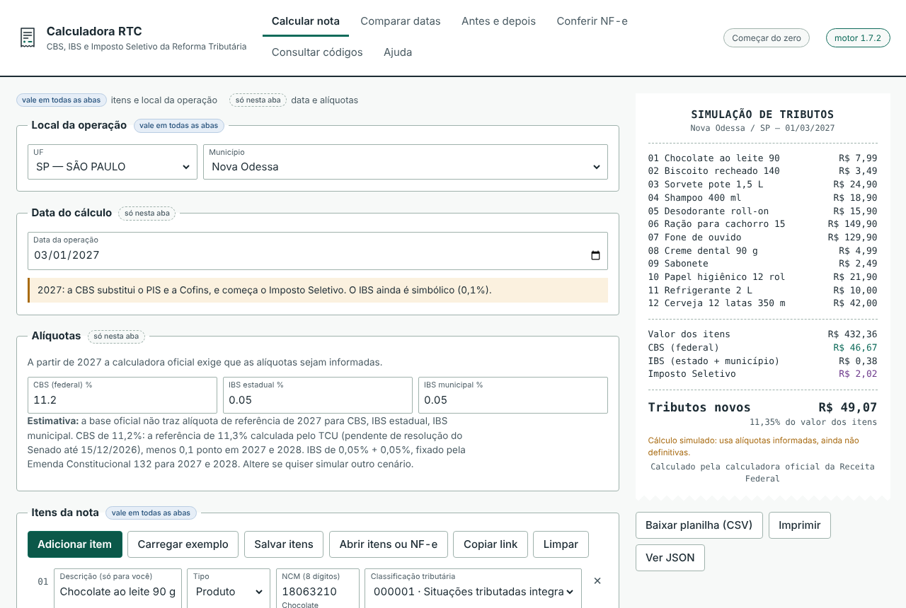
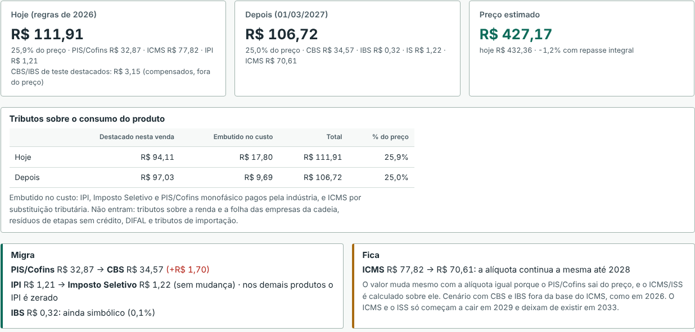
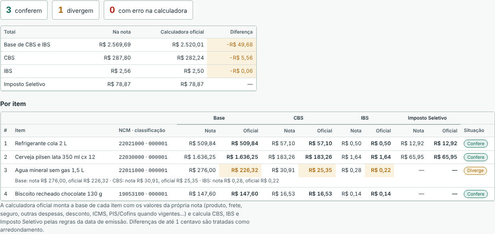
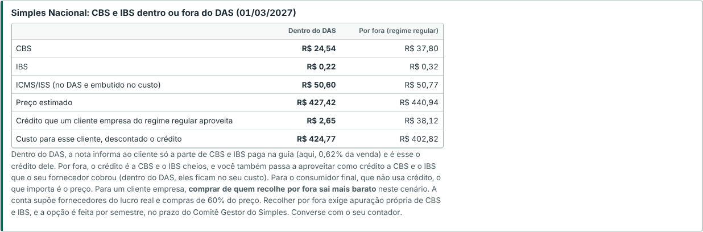

<div align="center">

<picture>
  <source media="(prefers-color-scheme: dark)" srcset="docs/imagens/icone-escuro.svg">
  
</picture>

# Calculadora RTC Fácil

**CBS, IBS e Imposto Seletivo da Reforma Tributária no seu computador, em português.**
Uma tela simples para a calculadora oficial da Receita Federal, que se instala com um clique
e **se atualiza sozinha** quando o governo publica uma versão nova.

[](https://github.com/Jano-Projects/calculadora-rtc-facil/actions/workflows/verificacao.yml)
[](https://github.com/Jano-Projects/calculadora-rtc-facil/actions/workflows/motor-oficial.yml)
[](https://github.com/Jano-Projects/calculadora-rtc-facil/releases/latest)
[](https://github.com/ReceitaFederal/calculadora-rtc-regime-regular)


[](https://github.com/Jano-Projects/calculadora-rtc-facil/releases)


[](LICENSE)



</div>

> 🧾 **Para quem quer entender e simular a reforma tributária do consumo**: empresas, contadores,
> estudantes e equipes que homologam sistemas emissores de nota fiscal.

---

## Sumário

- [O que ela faz](#o-que-ela-faz)
- [Como usar](#como-usar)
- [Telas](#telas)
- [Atualização automática](#atualização-automática)
- [Opções](#opções) · [Requisitos](#requisitos)
- [Documentação](#documentação)
- [Licença](#licença)

> [!IMPORTANT]
> Esta ferramenta **não é da Receita Federal**. Ela automatiza a instalação e oferece uma tela mais simples para a calculadora oficial, que continua fazendo os cálculos de CBS, IBS e Imposto Seletivo. Antes de usar os resultados, leia os **[pontos de atenção](docs/pontos-de-atencao.md)**.

## O que ela faz

| | |
|---|---|
| **Calcular nota** | Monte a nota item a item, com autocompletar de NCM e sugestão da classificação tributária. O resultado sai em forma de cupom, com o detalhamento de cada item. |
| **Comparar datas** | A mesma nota em 2026 (ano de teste) e em 2027 (CBS para valer e Imposto Seletivo). |
| **Antes e depois** | Os tributos sobre o consumo de hoje (PIS/Cofins, ICMS/ISS, FCP, IPI, monofásico, ICMS-ST) ao lado dos de depois da reforma. Mostra o que migra, o que fica, o que é destacado ou embutido no custo e o preço estimado. Vale para indústria ou comércio, no lucro real, no presumido ou no **Simples Nacional**, com a escolha de recolher CBS e IBS dentro ou fora do DAS. |
| **Conferir NF-e** | Abra o XML de uma NF-e ou NFC-e e confira, item por item, se a base, a CBS, o IBS e o Imposto Seletivo destacados batem com a calculadora oficial. Serve para homologar o cálculo de um sistema emissor. |
| **Compartilhar e imprimir** | Um link leva a mesma nota para outra Calculadora RTC Fácil, e cada aba vira PDF com as premissas usadas. |

- **Instaladores com ícone** para Windows, Debian/Ubuntu e Fedora, homologados automaticamente em cada sistema antes de cada versão. Abre pelo menu, sem terminal, e se encerra sozinha quando você fecha a aba. Não precisa de administrador, Git nem Java: o Java 25 é baixado na primeira abertura e renovado sozinho para receber as correções de segurança. Há também uma versão portátil, sem instalar.
- **Sempre na versão mais recente**: quando a Receita publica uma versão nova da [calculadora oficial](https://github.com/ReceitaFederal/calculadora-rtc-regime-regular), ela é baixada, compilada e posta em uso sozinha, sem fechar a tela. Um teste diário no GitHub confere se a versão nova funciona com a tela.
- **Valores de 2027 já preenchidos e explicados**: CBS de 11,2% e IBS de 0,1% enquanto a base oficial não traz a referência, e Imposto Seletivo pela MP 1.399/2026, a partir de 2 de fevereiro de 2027. A tela sempre mostra de onde vem cada número.
- **Tudo local**: os cálculos rodam na sua máquina, e nenhum dado das suas notas sai do computador.
- **100% código aberto** (licença MIT).

---

## Como usar

### 1. Instale

Na página de **[Releases](https://github.com/Jano-Projects/calculadora-rtc-facil/releases/latest)**, baixe o instalador do seu sistema:

| Sistema | Arquivo | Como instalar |
|---|---|---|
| **Windows 10/11** | `CalculadoraRTC-<versão>-instalador-windows.exe` | Dois cliques e *Avançar*. Não pede administrador. |
| **Debian, Ubuntu** e derivados | `calculadora-rtc_<versão>_all.deb` | Dois cliques no arquivo, ou `sudo apt install ./calculadora-rtc_<versão>_all.deb` |
| **Fedora** | `calculadora-rtc-<versão>-1.noarch.rpm` | Dois cliques no arquivo, ou `sudo dnf install ./calculadora-rtc-<versão>-1.noarch.rpm` |

Os instaladores têm menos de 1 MB: o Java e a calculadora oficial são baixados na primeira abertura, na pasta do seu usuário.

> [!NOTE]
> No Windows, o SmartScreen pode avisar que o instalador é de um editor desconhecido, porque ele não tem assinatura digital paga. Clique em **Mais informações → Executar assim mesmo**. As somas SHA-256 de cada arquivo estão no `SHA256SUMS.txt` da release.

### 2. Abra pelo ícone

Procure **Calculadora RTC** no Menu Iniciar ou no menu de aplicativos (a opção *Área de Trabalho* do instalador do Windows também cria um ícone lá). O navegador abre sozinho, sem terminal.

**Na primeira vez**, uma janela mostra o download do Java (~200 MB) e depois o navegador mostra a instalação da calculadora oficial: ela é baixada, ganha o banco de dados e é compilada, o que leva de **5 a 15 minutos**. Nas próximas vezes, abre em segundos.

**Para fechar**, basta fechar as abas da calculadora: ela se encerra sozinha 20 minutos depois. Para fechar na hora, use **Encerrar a calculadora**, na aba *Ajuda*, ou *Encerrar a Calculadora RTC* no menu de aplicativos. Abrir de novo com ela aberta só abre outra aba na mesma.

### 3. Versão portátil (sem instalar)

Para usar sem instalar, de um pendrive ou de uma pasta qualquer, baixe **`calculadora-rtc-facil-<versão>.zip`** na mesma página e extraia, ou clone com Git:

```bash
git clone https://github.com/Jano-Projects/calculadora-rtc-facil.git
```

| Sistema | O que fazer |
|---|---|
| **Windows 10/11** | Dê dois cliques em **`iniciar.bat`**. |
| **Linux** (Fedora, Debian, Ubuntu e derivados) | Abra o terminal na pasta e rode `bash iniciar.sh`. |

Nesse modo, **deixe a janela preta (terminal) aberta** enquanto usa e feche-a (ou aperte `Ctrl+C`) para encerrar. Tudo o que é baixado fica na pasta `dados/`, ao lado dos arquivos. `iniciar.bat --criar-atalho` e `bash iniciar.sh --criar-atalho` criam um atalho que abre o terminal.

### 4. Calcule

1. Escolha a **data** e o **local** da operação.
2. Adicione os itens (NCM ou NBS, classificação tributária, valor e quantidade). Se preferir, comece por um exemplo (*Cesta básica*, *Compras do dia a dia*, *Serviços de uma empresa do lucro presumido* ou *Exemplo da documentação oficial*) ou abra o XML de uma NF-e.
3. Clique em **Calcular tributos**.

Veja o [guia de uso](docs/guia-de-uso.md) para entender cada campo e o resultado.

---

## Telas

<table>
<tr>
<td width="50%"><a href="docs/imagens/calcular-nota.png"></a><br><sub><b>Calcular nota</b>: itens, alíquotas e o cupom com os tributos novos.</sub></td>
<td width="50%"><a href="docs/imagens/antes-e-depois.png"></a><br><sub><b>Antes e depois</b>: o que migra, o que fica e o preço estimado.</sub></td>
</tr>
<tr>
<td width="50%"><a href="docs/imagens/conferir-nfe.png"></a><br><sub><b>Conferir NF-e</b>: cada item da nota contra a calculadora oficial.</sub></td>
<td width="50%"><a href="docs/imagens/simples-nacional.png"></a><br><sub><b>Simples Nacional</b>: dentro ou fora do DAS, para o consumidor e para o cliente empresa.</sub></td>
</tr>
</table>

---

## Atualização automática

| O que atualiza | Como |
|---|---|
| **Calculadora oficial** (motor de cálculo) | Sozinha. Ao abrir e depois a cada 6 horas, o programa consulta as versões (tags) publicadas no repositório da Receita. Se houver uma nova, ele baixa, gera o banco, compila, sobe a versão nova e só então desliga a antiga, sem interromper quem está usando. Se algo falhar, a versão anterior continua funcionando. |
| **Java portátil** | Sozinho. A pasta `dados/jdk` é baixada de novo a cada 90 dias, para receber as correções de segurança do Java. Se o download falhar, a cópia atual continua em uso. |
| **Teste da versão oficial** | No GitHub, um teste instala a última versão da Receita em Windows, Ubuntu, Debian e Fedora e usa a tela como uma pessoa usaria. Ele roda toda manhã quando a Receita publicou uma versão ainda não testada, e toda segunda-feira em qualquer caso. Uma falha abre um aviso (*issue*) neste repositório. |
| **Esta ferramenta** (tela e scripts) | Instalada: baixe o instalador novo e instale por cima; o Java e o motor já baixados são aproveitados. Portátil com Git: `git pull`. Portátil pelo ZIP: baixe o ZIP novo e copie a pasta `dados/` antiga para dentro dele. |

A versão em uso aparece no canto superior direito da tela. Clique nela para ver detalhes ou forçar uma verificação.

## Opções

```
calculadora-rtc [opções]       (Linux, instalada: rode num terminal para ver o registro)
bash iniciar.sh [opções]       (Linux, portátil)
iniciar.bat  [opções]          (Windows, portátil)

  --porta N            porta do painel (padrão 8090)
  --rede               permite acessar de outros computadores da rede (ex.: de fora de uma VM)
  --sem-navegador      não abre o navegador automaticamente
  --sem-atualizacao    não procura versões novas (usa a instalada)
  --versao X           fixa uma versão da calculadora oficial (ex.: 1.7.3)
  --instalar-e-sair    só instala/atualiza o motor, testa e encerra
  --dados PASTA        onde guardar o Java, o motor e os registros (padrão: ./dados)
  --atalho             modo do ícone: encerra sozinha quando nenhuma aba estiver aberta
  --so-java            só baixa ou atualiza o Java portátil e encerra
  --criar-atalho       cria o atalho e encerra (versão portátil)
```

Variáveis de ambiente: `CALC_RTC_PORTA`, `CALC_RTC_HORAS_VERIFICACAO` (0 desliga a verificação periódica), `CALC_RTC_VERSAO`, `CALC_RTC_JAVA_HOME` (usar um JDK 25 já instalado), `CALC_RTC_REPO` (outro repositório/fork), `CALC_RTC_DADOS` (pasta de dados) e `CALC_RTC_ENCERRAR_MIN` (minutos sem abas abertas até encerrar no modo do ícone; 0 desliga).

## Requisitos

- Windows 10/11 (x64 ou ARM64), ou Linux x64/ARM64 (Debian, Ubuntu, Fedora e derivados). Os pacotes `.deb` e `.rpm` instalam o que falta; a versão portátil precisa de `curl` ou `wget` e `tar`, que já vêm nesses sistemas.
- ~1,5 GB livres na pasta do usuário (Java, dependências do Maven e motor compilado): `%LOCALAPPDATA%\CalculadoraRTC` no Windows e `~/.local/share/calculadora-rtc` no Linux, ou `dados/` na versão portátil.
- Internet na primeira execução e para receber atualizações. Depois disso funciona offline.

## Documentação

O [índice da documentação](docs/README.md) indica por onde começar conforme o que você quer fazer.

| Para quem usa | Técnico |
|---|---|
| [Pontos de atenção](docs/pontos-de-atencao.md): o que pode enganar nos resultados | [Como funciona](docs/como-funciona.md): arquitetura, atualização e arquivos |
| [Guia de uso](docs/guia-de-uso.md): cada aba, campo e resultado | [Solução de problemas](docs/solucao-de-problemas.md): quando algo não abre |
| [Entenda a reforma](docs/entenda-a-reforma.md): tributos, cronograma, Simples e glossário | [Desenvolvimento](docs/desenvolvimento.md): motor simulado, testes e CI |
| [Tributos e bases](docs/tributos-e-bases.md): bases, "imposto sobre imposto", destacado × embutido | [Como contribuir](CONTRIBUTING.md) |
| [Diferenças que confundem](docs/diferencas.md): calculado × simulado, NCM × NBS, CST × cClassTrib | [Segurança](SECURITY.md) |
| [Perguntas frequentes](docs/perguntas-frequentes.md) | [Mudanças](CHANGELOG.md) · [Código de conduta](CODE_OF_CONDUCT.md) |

## Licença

[MIT](LICENSE). A calculadora oficial tem licença própria, definida no [repositório da Receita Federal](https://github.com/ReceitaFederal/calculadora-rtc-regime-regular). O Java é o [Eclipse Temurin](https://adoptium.net) (GPLv2 com Classpath Exception).
